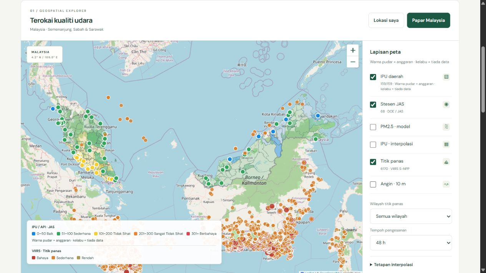

# Malaysia Haze Watch · Fire detection analysis

**Version 2.3.1 local review:** adds NASA GIBS imagery, tree-cover/peat context classification, DBSCAN groups, seven-day replay and fire analytics. Start with [FIRE-ANALYSIS.md](FIRE-ANALYSIS.md). Existing GitHub Pages and cron-job.org settings have not been changed by this local development. Preview: http://127.0.0.1:4177/.

A buildless, browser-only Web GIS for Malaysian haze monitoring. It combines official DOE station IPU observations, explicitly labelled district estimates, CAMS PM2.5, surface wind and NASA VIIRS hotspots. No application server, database, paid hosting or frontend secrets.

**Existing live site:** [eqal11.github.io/malaysia-haze-watch](https://eqal11.github.io/malaysia-haze-watch/). That deployment remains the previous version until these changes are uploaded. Local version 2.3: `http://127.0.0.1:4177/`.

## Visual sources and methodology

The navigation now opens [the bilingual visual guide](methodology.html): a collection-to-map flowchart, source and licence cards, analysis methods, detection-footprint illustration, update timing and interpretation limits. Technical documentation remains available here.

## Detection footprint polygons

Independent point and polygon checkboxes are available in the fire layer. Polygons dissolve unique nominal 375 m grid cells containing selected detections, preserving holes and gaps. They are **not confirmed burned-area boundaries**. Calculations run in a Web Worker using pinned MIT polygon-clipping 0.15.7, loaded only on demand. No new source observations, credentials or backend are required. See [POLYGONS.md](POLYGONS.md) for use, method and tests.

## Kebakaran hutan: heat detections in forested areas

Tree cover is labelled **Tutupan pokok**, never legal forest or a confirmed fire. NASA FIRMS heat anomalies do not establish the cause of haze. Popups state **Pengesanan haba, bukan bukti punca atau kawasan terbakar sebenar**.

Verified NASA GIBS WMTS: `VIIRS_SNPP_CorrectedReflectance_TrueColor`, EPSG:3857, `GoogleMapsCompatible_Level9`, 256-pixel JPEG tiles, zoom 0–9, CORS `*`, no key. Client-side last-seven-UTC-days imagery has a date picker, opacity and empty/error states, including blank HTTP-200 tiles. Credit: NASA GIBS/EOSDIS/Suomi NPP VIIRS; [NASA data-use guidance](https://www.earthdata.nasa.gov/engage/open-data-services-software/data-use-policy). Existing WorldCover/PEATMAP CC BY 4.0 and geoBoundaries/OSM ODbL notices remain applicable.

`scripts/classify_fires.py` uses existing land cover and peat context. Peat takes display precedence; original cover is preserved. Haversine DBSCAN defaults to 3 km, min_samples 2 and a 24h neighbour time gate, configurable in `data/fire-config.json`. No FRP cutoff discards smouldering peat detections. Outputs `forest_fires.geojson` and `fire_events.geojson` each stay under 5 MB. Noise is retained. The existing collector invokes analysis after attribution, retaining good files on failure and committing changes only.

Includes map circles, country/province/class/time/persistence filters, seven-day playback, province/class chart, 7/30-day archive trend, sortable top-10 groups and Malaysia/Indonesia counts. Persistence is distinct observed MYT days. Nominal unique 375 m cells give an approximate detection footprint, **not burned area**. Clouds, overpass gaps, dated land/peat maps, incomplete archives and changing group membership limit interpretation. No WDPA or Sentinel-2 dNBR confirmation is enabled; burn_confirmed remains null. See [full method, verified tile URL and upgrade instructions](FIRE-ANALYSIS.md) and [verification](FIRE-VERIFICATION.md).

## Hotspot land context

FIRMS detects heat anomalies. This analysis describes **land context**, not ignition mechanisms, ownership, responsibility or proof of a fire. Every attributed point has `on_peat` (boolean/null), `landcover` (string/null), `country` and `admin1` (string/null). Missing coverage remains null. The popup states: **Konteks tanah sahaja, bukan bukti punca kebakaran**.

| Input verified and downloaded | Format and licence | Bundled analysis input |
|---|---|---|
| [PEATMAP, University of Leeds, doi:10.5518/252](https://archive.researchdata.leeds.ac.uk/251/), [actual Asia ZIP](https://archive.researchdata.leeds.ac.uk/251/5/Asia.zip) | Shapefile, CC BY 4.0; ZIP MD5 `8893f779db40ecc53b19e66518230753` | `Asia/SEA_Peatland.shp`, inspected fields `Id`, `AREA`; original CRS ESRI:54034. Reprojected, repaired component-by-component, clipped to 95,-5,120,8, topology-preserving simplification 25 m in EPSG:6933, WGS84 GeoJSON precision 0.000001°. 3,659 valid polygons, about 3.87 MB. |
| [ESA WorldCover 2021 v200](https://doi.org/10.5281/zenodo.7254221), [official product manual and licence](https://esa-worldcover.s3.eu-central-1.amazonaws.com/v200/2021/docs/WorldCover_PUM_V2.0.pdf) | Categorical COG GeoTIFF, CC BY 4.0 | 39 actual AWS map tiles from the official grid. Supplied level-64 overviews, clipped and nearest-resampled to 0.006° (about 667 m at the equator), 271 KB. **Not native 10 m.** Actual numeric map codes, not RGB map tiles. |
| [geoBoundaries gbOpen Indonesia ADM1](https://www.geoboundaries.org/api/current/gbOpen/IDN/ADM1/) and existing Malaysia ADM1 | GeoJSON, ODbL 1.0, underlying OpenStreetMap / Wambacher | Actual `shapeName`/`shapeGroup` fields inspected for Indonesia; existing `name` for Malaysia. Boundaries represent 2017. No nearest-province guesses. |

**Method:** `scripts/attribute_hotspots.py` uses GeoPandas `sjoin(..., predicate="intersects")` for detection centres against peat and ADM1 polygons, plus Rasterio categorical sampling for cover. Exact peat polygon edges count as inside. Conflicting province matches become null. `on_peat=false` means outside mapped peat within an identified Malaysia/Indonesia polygon in the study extent; outside that known coverage is null. Existing detection coordinates, time, confidence and FRP are preserved. WorldCover tree cover can include plantations; it does not identify an operator or a particular crop.

**Updates and failure handling:** reference inputs are precomputed once, not downloaded every cron. The existing 30-minute Actions workflow fetches FIRMS, attributes detections, enriches available daily archives, validates and commits only changed data, then deploys. Each data file is limited to 5,000,000 bytes. Failed attribution preserves the last good output and records status in `meta.json`. The browser prefers a matching `hotspots_attributed.geojson`; if absent, invalid or mismatched with current raw detections, it uses `hotspots.geojson` with unknown context. Peat-only filtering uses strictly `true`. The stacked province chart includes mapped peat, outside mapped peat and unknown, follows map filters and selected 6/24/48-hour window, and counts detections rather than distinct fire events. Existing KPI and hourly charts retain their labelled 24h/48h windows.

**Limitations:** peat inputs represent Malaysia 2002–2009 and Indonesia 2005–2010, compiled in PEATMAP 2017; WorldCover represents 2021. They do not establish 2026 conditions. Point centres and polygon boundaries have positional error; simplification adds a 25 m tolerance in the stated projection. VIIRS nominal resolution is 375 m at nadir and varies with scan position, while this compact cover grid is about 667 m. Coastal gaps, unrecorded peat and land-cover classification errors are possible. Outside mapped peat does not prove peat absent. Historical detections use these same dated land reference layers, not a reconstructed daily land-cover map. No complete January 2026 FIRMS/IPU backfill has been fabricated.

**Attribution:** Xu, Morris, Liu and Holden (2017), University of Leeds, doi:10.5518/252. © ESA WorldCover project 2021 / Contains modified Copernicus Sentinel data (2021) processed by ESA WorldCover consortium. © OpenStreetMap contributors; geoBoundaries. See [data/context/LICENSES.md](data/context/LICENSES.md) and [sources.json](data/context/sources.json) for licences, every tile URL, checked fields and input checksums. Application code is MIT; derived attributed databases are ODbL 1.0 with source notices retained.

## Screenshots

Version 2.3: [fire map](assets/screenshots/fire-map.png), [fire dashboard](assets/screenshots/fire-dashboard.png), [mobile](assets/screenshots/fire-mobile.png).


Version 2.1: [land context chart](assets/screenshots/land-context-chart.jpg), [hotspot popup](assets/screenshots/land-context-popup.jpg), [mobile context chart](assets/screenshots/land-context-mobile.jpg).

Desktop and mobile screenshots from the local static-site verification are in [`assets/screenshots/`](assets/screenshots/). They show real source snapshots; values will change. See [`VERIFICATION.md`](VERIFICATION.md) for test evidence and deployment limits.



[Full desktop screenshot](assets/screenshots/desktop.jpg) · [Mobile screenshot](assets/screenshots/mobile.jpg)

## Quick start: GitHub Pages

1. Create a public GitHub repository, or fork this project. Put this directory's contents at the repository root, on the `main` branch.
2. In **Settings → Secrets and variables → Actions**, add `FIRMS_MAP_KEY`, obtained free from [NASA FIRMS](https://firms.modaps.eosdis.nasa.gov/api/map_key/). Never put the key in JS, repository files, screenshots or URLs in logs. If no key is set, the fetcher uses NASA's official public 48h CSV and identifies that transport in source status. An invalid configured key causes a visible failure and preserves the last good file; it is not silently ignored.
3. Enable Actions on the fork. Repository settings must allow the data job to write repository contents; its job-scoped token uses `contents: write`. Other jobs have only their required permissions. Branch protection must permit the bot's data commits, or adapt the workflow to a bot PR process.
4. Run **Refresh environmental data** manually. It then runs at minutes 11 and 41 each hour (UTC). GitHub schedules can be delayed; inactive public-repository schedules may be disabled by GitHub. Check the Actions page when freshness alerts appear.
5. In **Settings → Pages**, choose **GitHub Actions** as the source. Run **Deploy static Pages**, or push to `main`.
6. Open the deployment URL shown by the Pages job. There is no frontend install or build step.

`GITHUB_TOKEN` data commits do not trigger ordinary push workflows. The existing data workflow therefore refreshes and deploys in the same job. The separate Pages workflow still handles human code pushes and manual deployment. Retained good snapshots and failure metadata are published before an upstream or attribution failure is surfaced. Deploy artifacts contain only public HTML, CSS, JS, data and assets.

### Local development

Node 22+ runs the convenience server and frontend tests. Python 3.12 and the pinned `scripts/requirements-context.txt` packages run GIS attribution and validation. The frontend has no build step or npm dependencies, and the local collector requires Python and GIS packages. SETUP-LOCAL.bat installs them in a project virtual environment.

**Windows:** extract the complete ZIP, open the project directory and double-click `RUN-LOCAL.bat`. Leave its console window open, then visit `http://127.0.0.1:4177` in Chrome or Edge. Do not double-click `index.html`; `file://` blocks the modules/data loading required by this application. Internet access is required for CDN libraries, OSM tiles and model APIs. Closing the server window stops the local site. Local testing does not publish the project to the internet.

```sh
node scripts/serve.mjs
# Open http://127.0.0.1:4177; ES modules require HTTP.
python -m pip install -r scripts/requirements-context.txt
npm test
python -m unittest discover -s tests -p 'test_*.py' -v
python scripts/validate_data.py
python scripts/refresh_live.py
```

The local server collects immediately, then 15 minutes after each completed attempt. The browser reloads snapshots every five minutes, with model calls cached for one hour. Closing the server stops local collection. GitHub Actions supplies production updates separately.

The ingestion and attribution commands return a failure status when a source or processing step fails, after updating source health. They keep previous good files. `serve.mjs` is only a development utility; GitHub Pages hosts the production static files.

## Verified data sources and final endpoints

Verified with live HTTP requests on **21 October 2026**. Read [`data/boundaries/sources.json`](data/boundaries/sources.json) for the actual boundary release URLs and licences.

| Source | Endpoint and format | Auth / CORS | Source cadence / application cadence |
|---|---|---|---|
| data.gov.my | `https://api.data.gov.my/data-catalogue?id=air_pollution&limit=1` — JSON; [catalogue](https://data.gov.my/data-catalogue/air_pollution) | No key; not used by browser | Monthly national concentrations, **not current station IPU**. Rejected as the live IPU source. No suitable current station dataset was found in the catalogue search. |
| DOE MyEQMS | `https://eqms.doe.gov.my/api3/publicmapproxy/PUBLIC_DISPLAY/CAQM_MCAQM_Current_Reading/MapServer/0/query?f=json&outFields=*&returnGeometry=false&where=1%3D1` — ArcGIS JSON | No key; response restricts allowed origin to `https://eqmp.doe.gov.my`, so **Actions only** | Hourly observations; poll every 30 minutes. Public endpoint, not a documented stable API contract. |
| Open-Meteo air quality | `https://air-quality-api.open-meteo.com/v1/air-quality?latitude=…&longitude=…&current=pm2_5&domains=cams_global&timezone=GMT&timeformat=unixtime` — multi-location JSON | No key; verified `Access-Control-Allow-Origin: *` | Global CAMS model, typically two model runs daily with hourly output; browser fetch/cache one hour. Model time is shown, never labelled measured. |
| Open-Meteo forecast | `https://api.open-meteo.com/v1/forecast?latitude=…&longitude=…&current=wind_speed_10m,wind_direction_10m&wind_speed_unit=ms&timezone=GMT&timeformat=unixtime` — multi-location JSON | No key; verified wildcard CORS | Model-dependent updates; current output uses 15-minute intervals. Browser fetch/cache one hour. |
| FIRMS preferred | `https://firms.modaps.eosdis.nasa.gov/api/area/csv/{MAP_KEY}/VIIRS_SNPP_NRT/95,-5,120,8/3` — CSV | `FIRMS_MAP_KEY` secret; Actions only, no browser CORS dependency | Satellite overpasses, not continuous monitoring. Poll every 30 minutes. Three UTC calendar days requested, then filtered to a rolling 48h. |
| FIRMS fallback | `https://firms.modaps.eosdis.nasa.gov/data/active_fire/suomi-npp-viirs-c2/csv/SUOMI_VIIRS_C2_Global_48h.csv` — CSV | No key; Actions only | Successful live download verified; filter global CSV to `95,-5,120,8`, then rolling 48h. Used only when no secret is configured. |
| geoBoundaries | `https://www.geoboundaries.org/api/current/gbOpen/MYS/ADM2/`, plus MYS ADM0/ADM1 and IDN ADM0 — metadata JSON links to WGS84 GeoJSON | No key; bundled locally, no runtime CORS dependency | Static boundary release, not an observation feed. |
| OpenStreetMap | `https://tile.openstreetmap.org/{z}/{x}/{y}.png` — raster tiles | No key; standard browser tile requests, with attribution and Referer | Community-maintained basemap; obey the [tile usage policy](https://operations.osmfoundation.org/policies/tiles/). No bulk download, offline prefetch or cache bypass. |

The FIRMS area route returned `Invalid MAP_KEY.` for an intentionally invalid probe, confirming the route's auth requirement. **An authenticated area download could not be verified without a real secret.** The official documentation's schema was cross-checked against the real public CSV. The script accepts VIIRS `l/n/h` and `low/nominal/high` confidence representations.

CARTO's formerly keyless `light_all` tiles returned a PNG saying **API KEY REQUIRED** during live checks, so they are not used. The old APIMS hostname did not provide a usable live feed; the current MyEQMS public service was selected. DOE's portal and service metadata were inspected; metadata has an empty `copyrightText` and does not declare a reusable open-data licence. Public accessibility is not a grant of an open licence. This project's MIT licence covers code, not DOE observations. No login, CAPTCHA or access control is bypassed. Confirm DOE reuse conditions for your deployment and recheck them if the service changes.

Official references: [DOE APIMS](https://eqms.doe.gov.my/APIMS/main), [Open-Meteo AQ docs](https://open-meteo.com/en/docs/air-quality-api), [Forecast docs](https://open-meteo.com/en/docs), [FIRMS area docs](https://firms.modaps.eosdis.nasa.gov/api/area/), [FIRMS API tutorial](https://firms2.modaps.eosdis.nasa.gov/content/academy/data_api/firms_api_use.html).

## Methodology

### IPU and district representation

IPU uses the Malaysian scale, **not US AQI**: 0–50 Baik, >50–100 Sederhana, >100–200 Tidak Sihat, >200–300 Sangat Tidak Sihat, >300 Berbahaya. Null, non-finite, negative and sentinel `-1` values never become zero. District colours follow the official blue, green, yellow, orange and red sequence. Labels and dashed outlines supplement colour.

Point-in-polygon assigns stations to districts using WGS84 `[longitude, latitude]`. A district containing usable observations uses its **highest station reading**, not a claim of a district-wide measurement or average. Its popup identifies the station. A district without an observation uses IDW at a point inside its polygon. Estimates use a lighter fill and dashed boundary and are labelled **Anggaran / Estimated** in popups and rankings. Source pollutant names are reported as source-station pollutants for estimates; no pollutant is inferred from IPU alone. If no usable neighbour exists within the selected radius, the district is grey/unavailable.

Station observations older than six hours or more than an hour in the future are excluded from estimates and current KPI category counts. Their original values/times remain visible with stale indicators. The legacy `publicmapproxy` feed encodes Malaysian wall time in `DATETIME` epoch milliseconds; DOE's legacy popup displays the UTC hour of that value. The adapter explicitly subtracts eight hours, stores the normalized UTC ISO timestamp, and rejects future normalized timestamps. This is a **feed-specific convention**, not a generic ArcGIS epoch rule; changing sources requires re-verifying it. Hourly update races can produce null `DATETIME`; the last dated record for that station is retained with its original timestamp, never relabelled fresh.

### IDW and masks

`estimate(x) = Σ(value_i / distance_i^p) / Σ(1 / distance_i^p)`, using great-circle kilometres. Default `p=2`, cell size 15 km, radius 200 km. The UI supports powers 1–5, cells 8–50 km and radius 25–500 km. A point coinciding with observations returns their mean, avoiding division by zero. With no neighbours the result is null. Higher resolution does not add information to sparse inputs.

The optional-on-demand **IPU interpolation** uses usable DOE stations. **PM2.5 interpolation** uses 34 fixed land/coastal sampling locations from Open-Meteo's global CAMS model; these are **model samples, not PM2.5 monitoring stations**. The DOE feed supplies IPU rather than raw measured PM2.5 concentrations, so no measured PM2.5 station layer is claimed. PM2.5 is never converted into Malaysian IPU. Returned model coordinates and data times are retained.

Web Workers calculate grids in two regional windows. Browser canvases interpolate grid colours and apply polygon masks, including holes and islands, in Web Mercator coordinates before Leaflet image overlays are displayed. Only Malaysian district land selected by the state filter is included. The mask reflects generalized boundaries, not cadastral accuracy. Grid nodes outside land are not estimated.

Leave-one-out validation is included for the IPU raster: each station is predicted from all the others with the selected power/radius; RMSE, MAE and prediction coverage `n/total` are reported in IPU units. This measures spatial prediction at available stations, not forecast skill, health risk accuracy or model PM2.5 accuracy. Kriging is optional in the brief and is not included.

### Hotspots and wind

Risk is an **application-defined detection priority**, not an official hazard or exposure assessment. Thresholds live in `js/config.js`:

| Label | Rule (checked in this order) |
|---|---|
| Bahaya / High | VIIRS confidence `high` **or** FRP ≥ 50 MW |
| Sederhana / Moderate | confidence `nominal` **or** FRP ≥ 10 MW |
| Rendah / Low | Remaining low-confidence detections with FRP < 10 MW |

High/moderate/low markers use radii 7/4.5/3 pixels and red/orange/ochre colours. FRP is fire radiative power in MW. One detection is not one unique fire; repeated satellite passes are retained, exact location/time/sensor duplicates are removed. A point is not proof of smoke reaching Malaysia.

Countries are assigned against geoBoundaries MYS/IDN land polygons; unassigned points remain **Other**, never guessed to be Indonesia. The Sumatra/Kalimantan regional filter is an explicitly approximate geographic grouping within Indonesian land (Sumatra longitude <106°, Kalimantan longitude ≥108° and latitude <4.3°); nearby islands/border precision are limitations. This bounding box also includes parts of other countries. Regional filters, 6/24/48h windows and state selection apply to map points. The 24h KPI always counts 24h, and the history chart always spans 48h, with both respecting selected state and region. Selecting a state restricts hotspot statistics to that Malaysian state's land; Indonesia then correctly counts zero.

Wind speed/direction are 10m model fields. Convert meteorological **from** direction θ: `u=-speed*sin(θ)`, `v=-speed*cos(θ)`. Arrows and animated particles move downwind; nearby model vectors are sampled for visualization, with animation speed visually scaled. Colour bands: <2, 2–5, ≥5 m/s. The KPI is the arithmetic mean scalar speed and vector-mean from direction. The regional summary is only a simple surface-flow proxy: eastward western flow for Sumatra→Peninsula, northward eastern flow for Kalimantan→Sarawak. It does **not** compute trajectories, smoke transport, source attribution or vertical atmospheric flow. Reduced-motion users get static arrows.

## Data integrity, freshness and performance

- Real snapshots are included, with original observation times. Historical station charts accumulate observed snapshots; fewer than two real observations show an honest insufficient-history state. No backfilled, interpolated or fabricated temporal readings.
- Request timeout 45s in Python; three attempts with exponential backoff. Strict required fields, coordinates, dates and category validation. JSON writes use atomic replacements. Each source updates independently; a failure keeps its last-good file and records failure metadata. Errors avoid logging secret-bearing URLs.
- Browser request timeout 25s, model cache one hour in localStorage, manual refresh respects that model cache. Two batched Open-Meteo requests cover 34 points; API accounting may count multiple locations as multiple calls. No per-frame network requests. Free Open-Meteo service is [non-commercial only](https://open-meteo.com/en/terms), with published request limits. Public high-traffic installations may exceed service limits even with caching.
- Browser reloads static snapshots hourly. Source badges show both last successful fetch and observation/model time in `Asia/Kuala_Lumpur` (UTC+8). Stale thresholds: IPU 3h, FIRMS 4h, PM2.5 6h, wind 3h; configurable. FIRMS snapshot freshness is fetch time, not proof of complete satellite coverage. Old points are removed by rolling-window filters even when an old file is retained.
- Leaflet 1.9.4 and Chart.js 4.4.8 use pinned CDNs. Charts load near the viewport; the wind module and raster workers load only when toggled. Canvas renders thousands of detections; workers protect the main thread. External fonts have system fallbacks. Network failures display unavailable states. An invalid basemap response delivered as a valid image may not generate a browser tile error, which is why live visual QA matters.
- Mobile Lighthouse target: **85+**, not a measured or guaranteed score. A mobile Lighthouse audit was not available in this environment. Run Chrome DevTools Lighthouse against the deployed HTTPS site. See the verification report for actual checks completed.

## Boundaries and reproducibility

The pinned downloaded MYS release represents 2020 boundaries; **159 actual ADM2 features** were present even though the API metadata reports 160. This is not necessarily today's complete district roster. States were assigned by polygon vertex membership; small boundary differences and station positions near borders can affect assignment. No district boundary was invented.

One-time preparation is separate from scheduled refresh:

```sh
python scripts/prepare_boundaries.py
# mapshaper 0.7.93; repeat for each input, preserving shared district topology
npx --yes mapshaper@0.7.93 data/boundaries/districts.geojson -simplify weighted 40% keep-shapes -clean -o format=geojson precision=0.00001 force data/boundaries/districts.geojson
npx --yes mapshaper@0.7.93 data/boundaries/states.geojson -simplify weighted 15% keep-shapes -clean -o format=geojson precision=0.00001 force data/boundaries/states.geojson
npx --yes mapshaper@0.7.93 data/boundaries/malaysia.geojson -simplify weighted 10% keep-shapes -clean -o format=geojson precision=0.00001 force data/boundaries/malaysia.geojson
npx --yes mapshaper@0.7.93 data/boundaries/indonesia.geojson -simplify weighted 3% keep-shapes -clean -o format=geojson precision=0.00001 force data/boundaries/indonesia.geojson
python scripts/build_grid.py
python scripts/update.py
python scripts/validate_data.py
```

ADM2 is about **402 KB**, below the requested 3 MB budget. Boundary downloads use current metadata; exact release URLs from this delivery are recorded in `sources.json`. Rebuilding against a newer upstream release may change geometry. `mapshaper` is only for maintainers updating boundaries; the frontend and scheduled fetches have no build dependency.

## File tree

```text
.
├── .github/workflows/
│   ├── fetch-data.yml
│   └── pages.yml
├── assets/
│   ├── mark.svg
│   └── screenshots/
├── css/style.css
├── js/
│   ├── app.js
│   ├── config.js
│   ├── core.js
│   ├── dashboard.js
│   ├── data.js
│   ├── geometry.js
│   ├── i18n.js
│   ├── idw.js
│   ├── layers.js
│   ├── land-context.js
│   ├── history.js
│   ├── map.js
│   ├── raster-worker.js
│   └── wind.js
├── data/
│   ├── boundaries/{districts,states,malaysia,indonesia}.geojson
│   ├── boundaries/sources.json
│   ├── ipu.json
│   ├── hotspots.geojson
│   ├── hotspots_attributed.geojson
│   ├── context/{peat.geojson,indonesia-admin1.geojson,worldcover-2021.tif,sources.json,LICENSES.md}
│   ├── archive/{index.json,ipu/,hotspots/}
│   ├── meta.json
│   └── sampling-grid.json
├── scripts/
│   ├── prepare_boundaries.py
│   ├── build_grid.py
│   ├── fetch_ipu.py
│   ├── fetch_firms.py
│   ├── attribute_hotspots.py
│   ├── prepare_land_context.py
│   ├── requirements-context.txt
│   ├── archive_data.py
│   ├── bootstrap_recent.py
│   ├── import_history.py
│   ├── update.py
│   ├── utils.py
│   ├── validate_data.py
│   └── serve.mjs
├── tests/{test.mjs,history.mjs,land-context.mjs,test_ingestion.py,test_archive.py,test_land_context.py}
├── index.html
├── RUN-LOCAL.bat
├── package.json
├── .gitignore
├── .nojekyll
├── README.md
├── VERIFICATION.md
└── LICENSE
```

## Attribution and disclaimer

Code: MIT. **DOE Malaysia / Jabatan Alam Sekitar**: official station IPU, all data rights retained by its provider; see reuse limitation above. **NASA LANCE / FIRMS**, VIIRS S-NPP NRT: [NASA FIRMS](https://www.earthdata.nasa.gov/data/tools/firms); [citation guidance](https://www.earthdata.nasa.gov/data/tools/firms/citation). **Open-Meteo** weather API and **CAMS / Copernicus Atmosphere Monitoring Service** air quality forecasts: [AQ attribution and model references](https://open-meteo.com/en/docs/air-quality-api), CC BY 4.0 data, with free API use subject to non-commercial service terms. **OpenStreetMap contributors**, [ODbL attribution](https://www.openstreetmap.org/copyright), and OSM Foundation tile service. **geoBoundaries / William & Mary geoLab**, source providers and licences as listed individually in `data/boundaries/sources.json` (MYS ADM2: geoBoundaries, citypopulation.de, CC BY 3.0). Leaflet BSD-2-Clause; Chart.js MIT. Fonts DM Sans and Manrope under SIL Open Font License via Google Fonts.

Near real-time does not mean instantaneous. FIRMS detections depend on overpasses, cloud and processing; NRT products can lag by hours. Estimates are not measurements, model output is not local observed PM2.5, and absent detections do not prove absence of fire. Health text is general Malay guidance by category. **This is not an official health advisory**. Refer to [DOE Malaysia](https://eqms.doe.gov.my/APIMS/main), [MetMalaysia](https://www.met.gov.my/) and Malaysian health authorities for official decisions.
